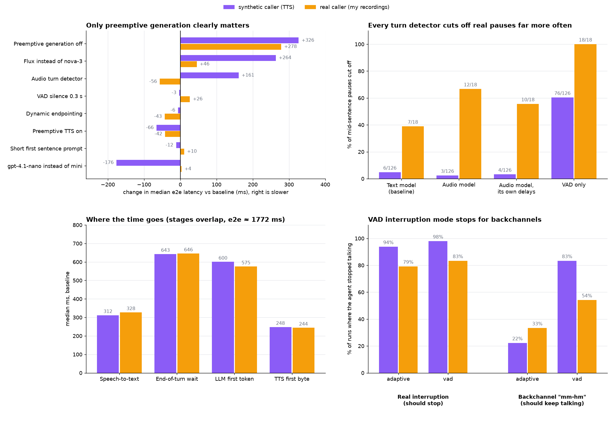

# first-word

A latency study of a voice agent built on [LiveKit Agents](https://docs.livekit.io/agents/). How long does it take from the moment the caller goes quiet to the agent's first word, and which settings change that?

A voice agent can get this wrong in two ways. It can be **slow**, leaving the caller in silence. Or it can be **rude**, jumping in while the caller is only pausing mid-sentence. Every setting here was measured on both.



## Setup

The agent is a simple rental-apartment receptionist. It's only there to give the pipeline something to answer.

- **Pipeline:** Deepgram nova-3 (STT) → gpt-4.1-mini → Deepgram Aura-2 (TTS), with Silero VAD and LiveKit's turn detector. LiveKit Agents 1.8.5, all settings in [`pipeline.py`](src/first_word/pipeline.py).
- **Bench:** audio clips are fed straight into the agent session in real time ([`harness.py`](bench/harness.py)), without a LiveKit room. WebRTC and network transport add a roughly constant offset and are out of scope.
- **Metrics:** LiveKit's per-turn metrics (`transcription_delay`, `end_of_turn_delay`, `llm_node_ttft`, `tts_node_ttfb`, `e2e_latency`), plus my own checks for cut-offs and interruptions.
- **Two caller sets:**
  - **Synthetic:** 95 clips read by a Deepgram TTS voice. Pauses are inserted at exact lengths (200 to 1000 ms), which makes sweeps possible.
  - **Real:** 36 recordings of my own voice, used to check whether the synthetic results hold for a human. The audio isn't published; the [manifest](bench/sets/natural/manifest.csv) lists what was said.

| Set | Caller | Agent should |
|---|---|---|
| S1 | asks a complete question | answer fast |
| S2 | pauses mid-sentence | wait (answering is a cut-off) |
| S3 | gives a very short answer ("Okay.") | answer fast |
| S4 | trails off | wait, then answer |
| S5 | interrupts the agent | stop talking |
| S6 | says "mm-hm" while the agent talks | keep talking |

Each experiment changes one setting against the baseline (the defaults above). Variants are interleaved in blocks and repeated three times. 18 experiments, 4,176 runs, about $19 in API costs. Every experiment has its config and a generated `report.md` in [`results/`](results), and the raw per-run rows are in `runs.jsonl`.

## Findings

Numbers are medians. "e2e" is the time from the end of the caller's speech to the agent's first audio. It was about 1770 ms with the baseline on both sets.

**1. Preemptive generation is the only setting that clearly saves time, about 300 ms.**
Turning it off made replies 326 ms slower on synthetic speech and 278 ms slower on real speech. After the caller stops, two things run in parallel:
- **Deciding** that the turn is over (VAD silence plus the turn detector), done at about 640 ms.
- **Building** the answer (transcript → LLM → first sentence → TTS), which takes much longer.

The answer is the critical path. Preemptive generation starts it at the transcript (~310 ms) instead of after the decision (~640 ms), which is almost exactly the difference measured.

**2. Speeding up the decision doesn't speed up the reply.**
For the same reason, a shorter VAD silence window (0.3 or 0.4 s instead of 0.55 s) cut the end-of-turn wait from 650 to 500 ms, but e2e didn't change (1810 vs 1808 ms). It only added cut-offs. Dynamic endpointing, preemptive TTS and a "start with a short sentence" prompt didn't move e2e meaningfully either.

**3. The turn detector decides how rude the agent is, and real pauses are much harder than synthetic ones.**
Share of mid-sentence pauses (S2) that the agent cut off:

| Turn detection | Synthetic | Real |
|---|---|---|
| Text model (`MultilingualModel`, baseline) | 6/126 | 7/18 |
| Audio model (`inference.TurnDetector`) | 3/126 | 12/18 |
| Audio model with its own 0.3/2.5 s delays | 4/126 | 10/18 |
| VAD only | 76/126 | 18/18 |

Without a detector the agent cut off every real pause. With one, every detector still did several times worse on my voice than on the TTS voice. The newer audio model went from best on synthetic speech to worst on real speech. That last result rests on 18 runs from one speaker, so it's a strong hint rather than a conclusion. Either way, a benchmark that only uses TTS callers makes turn-taking look much better than it is.

**4. Flux removes cut-offs but costs speed.**
Deepgram Flux had 0 cut-offs on both sets, but its transcripts arrived later (674 vs 306 ms), which made replies 264 ms slower on synthetic speech. On real speech the median was close, but p95 was about 500 ms worse. Flux's early "preflight" transcripts are meant to fix this; I haven't tuned them here.

**5. For voice, time to the first sentence matters more than time to the first token.**
gpt-4.1-nano replied 176 ms faster than gpt-4.1-mini on synthetic speech, but its first token wasn't faster (570 vs 579 ms). The gain came from reaching the first full sentence 100 ms sooner, which TTS needs before it can speak. On real speech there was no gain, and answer quality wasn't compared.

**6. VAD interruption mode stops for backchannels.**
Both modes stopped for nearly all real interruptions. But VAD mode also stopped for "mm-hm" in 83% of synthetic runs and 54% of real ones. LiveKit's adaptive mode (the default) did so in 22% and 33%.

### Caveats

- The real set is small: one speaker, 6 pause clips × 3 repeats per variant.
- On real speech, both interruption modes took about 4 s to stop. That's slower than on synthetic speech, and I haven't ruled out a problem in how the bench measures it.
- Clips are single turns, so dynamic endpointing, which learns from earlier turns, had nothing to learn from.
- Trailing-off clips (S4) always waited the full 3 s maximum.
- Three synthetic S1 clips (s1_05, s1_06, s1_18) count as cut-offs in every experiment. The TTS voice pauses after "and", so this is a flaw in the clips, not the agent.

## Running it

Requires [uv](https://docs.astral.sh/uv/), a LiveKit Cloud project, and Deepgram and OpenAI keys.

```
cp .env.example .env.local   # fill in the keys
uv sync
uv run python src/first_word/agent.py download-files
uv run python src/first_word/agent.py console   # talk to the agent
```

To run the bench:

```
uv run python bench/generate_synthetic.py        # synthesize the synthetic set
uv run python bench/record.py                    # record your own set
uv run python bench/run.py bench/configs/pilot.toml
bench/night.sh                                   # all experiments, resumable
uv run python bench/plot.py                      # redraw results/findings.png
```

`run.py` checkpoints every run, keeps a running cost estimate with a hard budget cap, and writes `results/<experiment>/report.md`.
